# Arte dos itens — revisão e catálogo de conceitos

Direção de arte dos 130 desenhos de item (13 famílias × 5 níveis, comum e mágico) no padrão novo
(`docs/ARTE_TIBIA.md`: 128 px por tile, corpo base vestido pelo kit da classe). Nada aqui muda regra de jogo;
os renomes propostos (seção 5) mudam só o nome mostrado e precisam de migration.

---

## 1. Revisão da arte atual

| Onde | Como está | Problema |
|---|---|---|
| Ícones (16×16) | um desenho por família, recolorido por nível | a Espada curta e a Lâmina do dragão têm a mesma forma; machados, arcos, bestas, varinhas, cajados, chapéus, mantos, calças e botas idem |
| Ícones dos mágicos | o ícone do nível com um ponto roxo no canto | a Espada Vorpal é igual à espada de mithral |
| Vestidos (comuns) | forma muda por nível (gorro → elmo com chifres), em 48 px | genéricos e pouco detalhe; escamas de dragão viram mancha vermelha; arcos, cajados e chapéus mudam pouco |
| Vestidos (mágicos) | desenho do nível com material próprio e às vezes um enfeite | a maioria é o comum recolorido; só alguns têm forma própria (Couraça do Leão, Elmo do Grifo, Botas Aladas) |
| Tamanho das armas | todas do mesmo tamanho em todos os níveis | a arma de nível 5 não impressiona |

## 2. Inspiração em Dungeons & Dragons

O Kusa é um RPG com tema de D&D, e o catálogo já nasceu assim: quase todos os itens mágicos têm nome de item
mágico clássico de D&D (Espada Vorpal = *Vorpal Sword*, Vingadora Sagrada = *Holy Avenger*, Botas Aladas =
*Winged Boots*...). A arte segue a mesma regra:

1. **O desenho do mágico parte do que o item faz em D&D.** A Espada Dançarina flutua e luta sozinha, então é
   desenhada flutuando ao lado do herói; o Escudo Animado também; o Elmo do Brilho é cravejado de gemas; o
   Manto das Estrelas é o céu noturno. Cada mágico abaixo traz a referência em itálico.
2. **Criaturas de D&D como motivo**: corujurso (owlbear), grifo, lobo e lobisomem, víbora, mímico, gigantes,
   anões, elfos, gnomos inventores, demônios do Abismo e, acima de todos, os dragões cromáticos (o nível 5).
3. **Materiais de D&D**: mithral é material clássico de D&D (leve, élfico e anão); o nível 5 é a "armadura de
   escamas de dragão" (*Dragon Scale Mail*).
4. **Só o que é aberto**: nomes e criaturas do SRD 5.1 de D&D (licença CC BY 4.0) e mitologia comum. Ficam de
   fora criaturas que não estão no SRD, como o observador (*beholder*), o devorador de mentes (*mind flayer*) e a
   fera deslocadora (*displacer beast*), e nada é copiado de ilustração dos livros.

## 3. Princípios novos

1. **Cada item tem silhueta própria**, inclusive o raro (+1 ganha um enfeite: fita, gema, gravura) e o mágico
   (forma própria, nunca o comum recolorido).
2. **Tema por nível** (material + motivo), para o nível ser lido de longe:

| Nível | Material | Motivo e estilo |
|---|---|---|
| 1 Rústico | couro cru, madeira, osso, linho, pedra amarrada | caçador da floresta: javali, lobo jovem, costura grossa |
| 2 Bronze | bronze com azinhavre, crina, couro tingido | antigo mediterrâneo: touro, leão, crista de crina, gravuras |
| 3 Ferro | ferro rebitado, malha, couro preto | medieval nórdico: corvo, urso, runas gastas, marcas de uso |
| 4 Mithral | prata azulada, filigrana, gemas azuis | élfico e anão: folhas, cervo, grifo, curvas finas |
| 5 Dragão | escama, chifre, dente, ferro negro, brasa | dragão: asas, garras, olhos de réptil, runas acesas |

3. **Mágicos são criaturas e ideias de D&D** (seção 2): lobo, demônio, corujurso, grifo, víbora, gigantes, sol, estrelas. O efeito mágico
   aparece no desenho (fogo na lâmina que queima, gota na que rouba vida, raios na que acelera).
4. **Arma cresce com o nível**: nível 1 do tamanho do antebraço; nível 5 maior que o herói (montante, machadão,
   arco da altura do corpo). Armas grandes são seguradas em pé ao lado do corpo.
5. **O item é o mesmo em qualquer classe** e cobre só o que veste; o resto continua mostrando a classe.
6. **Ícones em 32×32**, um por item (65 comuns + 65 mágicos), feitos a partir do mesmo desenho do vestido.

## 4. Catálogo de conceitos

Formato: **nome** — conceito *(referência de D&D, quando há)*. ✅ = já desenhado no piloto.

### Espada (cavaleiro)
| Nível | Comum | Mágico |
|---|---|---|
| 1 | **Espada curta** ✅ — gládio largo, cabo de madeira com cordão | **Espada do Juramento** ✅ — sulco vermelho que "bebe" o sangue até a gema da guarda, fita de juramento no cabo *(Sword of Life Stealing)* |
| 2 | **Espada de bronze** ✅ — lâmina em folha, pomo em cabeça de touro | **Lâmina Flamejante** ✅ — lâmina ondulada, chamas acesas ao longo do gume *(Flame Tongue)* |
| 3 | **Espada longa** ✅ — bastarda, guarda reta, pomo de disco, couro preto | **Vingadora Sagrada** ✅ — espada do paladino lendário: guarda em asas de anjo, sol dourado, lâmina com luz *(Holy Avenger)* |
| 4 | **Espada de mithral** ✅ — lâmina élfica curva com folhas gravadas, guarda em galhos | **Espada Dançarina** ✅ — rapieira de guarda em fita espiral que flutua e luta ao lado do herói *(Dancing Sword)* |
| 5 | **Lâmina do dragão** ✅ — montante de duas mãos, dentes de dragão no gume, runas em brasa, guarda em asas | **Espada Vorpal** ✅ — obsidiana negra, gume finíssimo com rastro roxo, crânio na guarda (a que corta cabeças) *(Vorpal Sword)* |

### Machado (cavaleiro)
| Nível | Comum | Mágico |
|---|---|---|
| 1 | **Machadinha** ✅ — pedra amarrada com couro num galho | **Machado do Berserker** ✅ — gume em mandíbula de urso, pelo no cabo, olhos vermelhos de fúria *(Berserker Axe)* |
| 2 | **Machado de bronze** ✅ — meia-lua com dois furos | **Machado Uivante** ✅ — a lâmina é uma cabeça de lobo uivando, linhas de vento *(lobisomens e worgs)* |
| 3 | **Machado de batalha** ✅ — lâmina dupla nórdica com corvo gravado | **Machado dos Reis Anões** ✅ — rosto de rei anão em relevo, runas, anéis no cabo *(Axe of the Dwarvish Lords)* |
| 4 | **Machado de mithral** ✅ — lâmina em asa de grifo, cabo branco | **Machado da Tempestade** ✅ — machado de gigante da tempestade, relâmpago encravado, faíscas *(storm giants)* |
| 5 | **Grande machado do dragão** ✅ — duas lâminas em asas de dragão e crânio no centro | **Ruína dos Gigantes** ✅ — machadão maior que o herói com dentes de gigante como troféu *(Giant Slayer)* |

### Arco (paladino)
| Nível | Comum | Mágico |
|---|---|---|
| 1 | **Arco curto** — galho com casca | **Arco do Caçador Élfico** — pontas em galhada de cervo, escrita élfica *(elfos da floresta)* |
| 2 | **Arco de caça** — recurvo com couro e penas penduradas | **Arco do Vento Sul** — pontas em asas de gaivota, fitas ao vento |
| 3 | **Arco longo** — teixo quase da altura do herói | **Arco Solar** — dourado, disco solar na empunhadura, flechas de luz *(como a Sun Blade)* |
| 4 | **Arco de mithral** — folha dupla prateada | **Arco do Juramento** — arco élfico que sussurra "derrota rápida aos meus inimigos": inscrição élfica que acende *(Oathbow)* |
| 5 | **Arco de osso de dragão** — costelas de dragão, corda de tendão vermelho | **Arco de Corda Celestial** — arco de nuvem com corda de luz estelar |

### Besta (paladino)
| Nível | Comum | Mágico |
|---|---|---|
| 1 | **Besta leve** — madeira e corda de cânhamo | **Besta do Sentinela** — escudo-pavês acoplado na frente |
| 2 | **Besta de bronze** — coronha gravada com touro | **Besta do Caça-Vampiros** — virotes de prata, símbolo sagrado e réstia de alho *(caçadores de Ravenloft)* |
| 3 | **Besta de ferro** — manivela e estribo | **Besta de Repetição Gnoma** — tambor giratório e engrenagens *(gnomos inventores)* |
| 4 | **Besta pesada de mithral** — arco duplo élfico | **Besta Trovejante** — arco de cobre com bobinas e faíscas |
| 5 | **Balestra de osso de dragão** — crânio de dragão como corpo, arco em asas | **Balestra do Dragão Rubro** — o virote sai em chamas da boca aberta do dragão |

### Varinha (feiticeiro e druida)
| Nível | Comum | Mágico |
|---|---|---|
| 1 | **Varinha de salgueiro** — raminho com duas folhas | **Varinha de Mísseis Mágicos** — três dardos de luz girando na ponta *(Wand of Magic Missiles)* |
| 2 | **Varinha de bronze** — mãozinha segurando uma esfera | **Varinha da Bola de Fogo** — salamandra enrolada na ponta, conta de fogo *(Wand of Fireballs)* |
| 3 | **Varinha rúnica** — osso com runas que acendem | **Varinha do Mago de Guerra** — varinha de batalha com guarda de metal *(Wand of the War Mage)* |
| 4 | **Varinha de mithral** — cristal azul facetado | **Varinha dos Segredos** — chave na ponta e um olho que abre perto de portas secretas e armadilhas *(Wand of Secrets)* |
| 5 | **Varinha de dente de dragão** — presa curva com gema | **Varinha das Maravilhas** — espiral de arco-íris, cada disparo de uma cor *(Wand of Wonder)* |

### Cajado (feiticeiro e druida)
| Nível | Comum | Mágico |
|---|---|---|
| 1 | **Cajado de carvalho** — torto, raízes segurando uma pedra | **Cajado da Floresta** — galho vivo com folhas e um ninho *(Staff of the Woodlands)* |
| 2 | **Cajado de bronze** — lua crescente no topo | **Cajado da Víbora** — a ponta vira uma cabeça de serpente viva, veneno verde nas presas *(Staff of the Adder)* |
| 3 | **Cajado rúnico** — obelisco no topo com runas flutuando | **Cajado do Poder** — esfera de energia cercada por anéis *(Staff of Power)* |
| 4 | **Cajado de mithral** — aro élfico com cristal suspenso | **Cajado do Arquimago** — estrela de 8 pontas com órbitas *(Staff of the Magi)* |
| 5 | **Cajado de presa de dragão** — crânio de dragão no topo, olhos acesos | **Cajado do Dragão Ancião** — dragão enrolado no cajado segurando a gema na garra *(dragões anciões)* |

### Elmo de guerra (cavaleiro e paladino)
| Nível | Comum | Mágico |
|---|---|---|
| 1 | **Gorro de couro** ✅ — capuz acolchoado com abas nas orelhas | **Gorro do Escudeiro** ✅ — pena de faisão e brasão costurado |
| 2 | **Elmo de bronze** ✅ — coríntio com crista de crina vermelha | **Elmo do Vigia** ✅ — viseira em cara de corujurso, bico e olhos grandes, penas e pelo *(owlbear)* |
| 3 | **Elmo de ferro** ✅ — nórdico com nasal e malha | **Elmo do Brilho** ✅ — elmo cravejado de gemas (diamante, rubi, opala de fogo) com chamas leves em volta *(Helm of Brilliance)* |
| 4 | **Elmo de mithral** ✅ — elmo fechado com coroa de folhas e penacho | **Elmo do Cavaleiro Grifo** ✅ — viseira em bico de grifo, asas nas laterais *(griffon riders)* |
| 5 | **Elmo do dragão** ✅ — cabeça de dragão de mandíbula aberta emoldurando o rosto | **Elmo do Demônio** ✅ *(hoje "Elmo do Senhor dos Dragões")* — viseira de cara de demônio, olhos em brasa, presas, chifres de carneiro *(Demon Armor, demônios do Abismo)* |

### Armadura de guerra (cavaleiro e paladino)
| Nível | Comum | Mágico |
|---|---|---|
| 1 | **Gibão de couro** ✅ — couro com tachas, pele de lobo num ombro | **Gibão do Aventureiro** ✅ — bolsos, corda enrolada, mapa e uma bolsa de carga no cinto *(Bag of Holding)* |
| 2 | **Couraça de bronze** ✅ — peitoral musculado com saiote de tiras | **Couraça do Leão** ✅ — cabeça de leão no peito, juba como ombreiras *(mitologia: leão de Nemeia)* |
| 3 | **Cota de malha** ✅ — malha com tabardo na cor da classe | **Cota Élfica** ✅ — malha fina prateada com folhas *(Elven Chain)* |
| 4 | **Placas de mithral** ✅ — ombreiras em concha, peito com filigrana | **Armadura de Placas Anã** ✅ — placas grossas com rosto anão e runas *(Dwarven Plate)* |
| 5 | **Escamas de dragão** ✅ — escamas sobrepostas, ombreiras em crânio | **Escamas do Dragão Vermelho** ✅ — escamas vermelhas, espinhos e asinhas nas costas *(Dragon Scale Mail)* |

### Perneiras de guerra (cavaleiro e paladino)
| Nível | Comum | Mágico |
|---|---|---|
| 1 | **Calças de couro** — joelheiras costuradas | **Calças do Viajante** — bolsos e cantil |
| 2 | **Perneiras de bronze** — grevas com joelho em cabeça de touro | **Perneiras do Gladiador** — tiras de couro, uma greva só (assimétrica) |
| 3 | **Perneiras de malha** — malha com joelheira rebitada | **Perneiras de Malha Élfica** — malha fina com folhas na barra |
| 4 | **Coxotes de mithral** — joelheiras com cara de leão | **Coxotes do Guardião** — escudinhos nas coxas |
| 5 | **Perneiras de escamas de dragão** — garras nos joelhos | **Perneiras do Dragão** — espinhos nas canelas |

### Chapéu arcano (feiticeiro e druida)
| Nível | Comum | Mágico |
|---|---|---|
| 1 | **Capuz de lã** — capuz simples com cordão | **Capuz do Lobo** ✅ *(hoje "Capuz do Eremita")* — pele de lobo com a cabeça por cima da testa, caindo nos ombros *(Forma Selvagem do druida)* |
| 2 | **Chapéu pontudo** — aba mole, remendos, ponta caída | **Chapéu do Ilusionista** — listras que trocam de cor, ponta torta com estrela *(Hat of Disguise)* |
| 3 | **Capuz rúnico** — runas acesas na borda | **Capuz da Clarividência** — terceiro olho aberto na testa *(magia Clarividência)* |
| 4 | **Chapéu do mago** — aba larga com lua e estrelas | **Chapéu do Arquimago** — altíssimo, anéis orbitando *(Hat of Wizardry)* |
| 5 | **Coroa de chifres de dragão** — coroa de chifres | **Diadema do Dragão Ancião** — dragão mordendo a própria cauda, gema na testa |

### Manto arcano (feiticeiro e druida)
| Nível | Comum | Mágico |
|---|---|---|
| 1 | **Túnica de linho** — remendos e cordão | **Túnica do Aprendiz** — remendos que são objetos costurados (corda, lanterna, adaga), livro no cinto *(Robe of Useful Items)* |
| 2 | **Manto de viagem** — capa curta com capuz e broche | **Manto Élfico** — capa de folhas sobrepostas, capuz que esconde o rosto *(Cloak of Elvenkind)* |
| 3 | **Manto rúnico** — runas acesas na barra | **Manto da Proteção** — ombreiras em escudo com runas *(Cloak of Protection)* |
| 4 | **Vestes de mithral** — gola alta prateada, constelação bordada | **Manto do Arquimago** — gola enorme, bordado de runas que brilha *(Robe of the Archmagi)* |
| 5 | **Manto de seda de dragão** — mantelete de escamas, capa em asa | **Manto das Estrelas** — céu noturno dentro do manto, estrelas piscando *(Robe of Stars)* |

### Calças arcanas (feiticeiro e druida)
| Nível | Comum | Mágico |
|---|---|---|
| 1 | **Calças de linho** — barra dobrada | **Calças do Novato** — remendos coloridos |
| 2 | **Calças de lã** — listras e remendo no joelho | **Calças de Seda Encantada** — brilho furta-cor |
| 3 | **Calças rúnicas** — runas na lateral | **Calças do Vidente** — olhos bordados |
| 4 | **Calças de mithral** — bordado prateado | **Calças do Conjurador** — bolsinhos de componentes |
| 5 | **Calças de couro de dragão** — escamas nas canelas | **Calças da Asa do Dragão** — membranas de asa na lateral |

### Botas (todos)
| Nível | Comum | Mágico |
|---|---|---|
| 1 | **Botas de couro** — dobra no cano, cadarço | **Botas Élficas** — ponta curva com folhas, passos sem som *(Boots of Elvenkind)* |
| 2 | **Botas de bronze** — sandália com grevas | **Botas do Andarilho** — couro gasto, polainas e molas no salto *(Boots of Striding and Springing)* |
| 3 | **Grevas de ferro** — grevas até o joelho | **Botas da Rapidez** — raios nas laterais e esporas que batem *(Boots of Speed)* |
| 4 | **Botas de mithral** — sabatons em lâminas | **Botas Aladas** — asas no tornozelo *(Winged Boots)* |
| 5 | **Botas de escamas de dragão** — garras no lugar dos dedos | **Botas do Dragão Alado** — garras e asas |

### Escudo (todos)
| Nível | Comum | Mágico |
|---|---|---|
| 1 | **Broquel de madeira** — tábuas e aro de couro | **Broquel do Escudeiro** — brasão de família pintado |
| 2 | **Escudo de bronze** — redondo hoplita com touro | **Escudo Sentinela** — olho que vigia no centro *(Sentinel Shield)* |
| 3 | **Escudo de ferro** — pipa com cruz rebitada | **Escudo Animado** — flutua sozinho ao lado do herói, com o rosto vivo de um mímico *(Animated Shield)* |
| 4 | **Escudo de mithral** — torre élfica com árvore | **Escudo da Guarda Arcana** — círculo mágico girando na frente *(Spellguard Shield)* |
| 5 | **Escudo do dragão** — escamas com cabeça de dragão | **Escudo do Dragão Ancião** — cabeça de dragão em relevo saindo do escudo |

## 5. Renomes propostos

Só o nome muda (o id, os atributos e o preço continuam). Precisa de migration no `market_items` e de mudar o
`packages/shared/src/items.ts` junto.

| Hoje | Proposta | Por quê |
|---|---|---|
| Elmo do Senhor dos Dragões | Elmo do Demônio | o nível 5 comum já é o Elmo do dragão; o demônio dá uma criatura nova ao topo (*Demon Armor*). O Elmo do Brilho fica, porque é item de D&D (*Helm of Brilliance*) |
| Capuz do Eremita | Capuz do Lobo | a pele de lobo pede o nome; segue dando mana |

## 6. Lote 1 desenhado

Espadas, elmos de guerra e armaduras de guerra, os 5 níveis comuns de cada (15 itens), no corpo novo, de frente,
de lado e de costas. Cavaleiro nos níveis ímpares e paladino nos pares, para mostrar o mesmo desenho nas duas
classes. Código em `apps/client/src/art/proto/tibiaHero.ts`; galeria `arte.html`, seções "Itens · lote 1".

**Conjunto de cada nível** (elmo + armadura + espada, do rústico ao dragão):

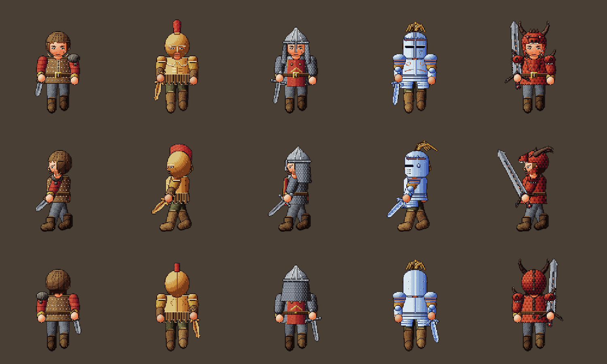

**Espadas** (curta, bronze, longa, mithral, Lâmina do dragão):

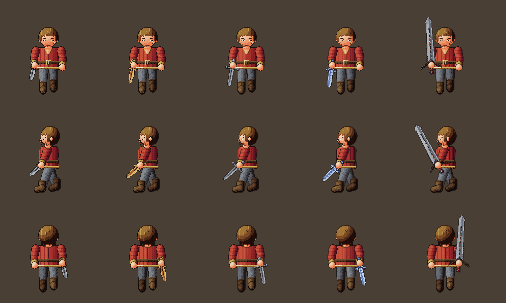

**Elmos de guerra** (gorro de couro, coríntio de bronze, nórdico de ferro, fechado de mithral, cabeça de dragão):

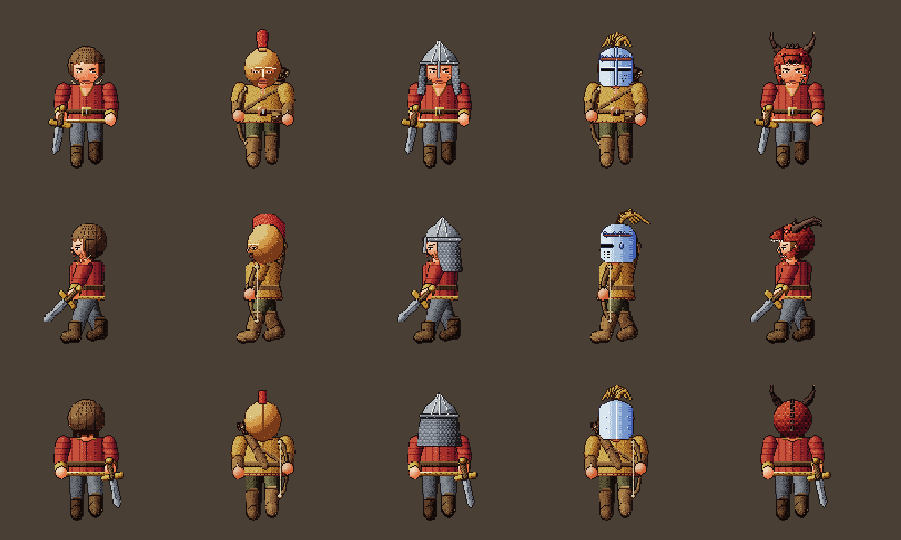

**Armaduras de guerra** (gibão com pele de lobo, couraça musculada com saiote de tiras, cota de malha com tabardo
na cor da classe, placas de mithral com ombreiras em concha, escamas com ombreiras em crânio de dragão):

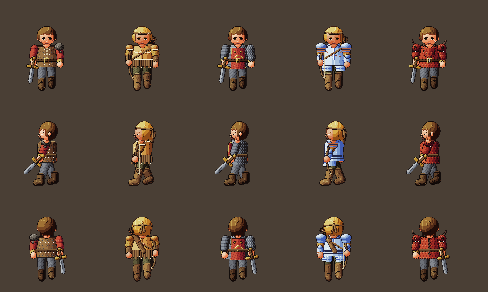

## 7. Lote 2 desenhado

Os 15 mágicos de espada, elmo de guerra e armadura de guerra, cada um com forma própria a partir do item de D&D
(o Elmo do Demônio é o do piloto). Cavaleiro nos níveis ímpares e paladino nos pares.

**Conjunto mágico de cada nível**:

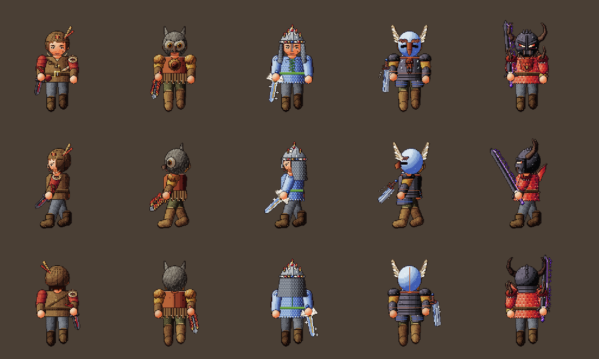

**Espadas mágicas**: Espada do Juramento (sulco vermelho até a gema e fita), Lâmina Flamejante (lâmina ondulada
em chamas), Vingadora Sagrada (asas de anjo, sol e luz), Espada Dançarina (flutua sozinha ao lado do herói, com
rastro), Espada Vorpal (obsidiana com gume violeta e crânio na guarda):

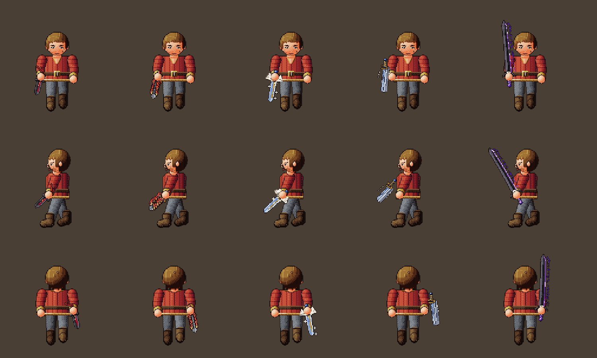

**Elmos mágicos**: Gorro do Escudeiro (pena de faisão e brasão), Elmo do Vigia (cara de corujurso), Elmo do Brilho
(gemas e chamas), Elmo do Cavaleiro Grifo (bico de grifo e asas), Elmo do Demônio:

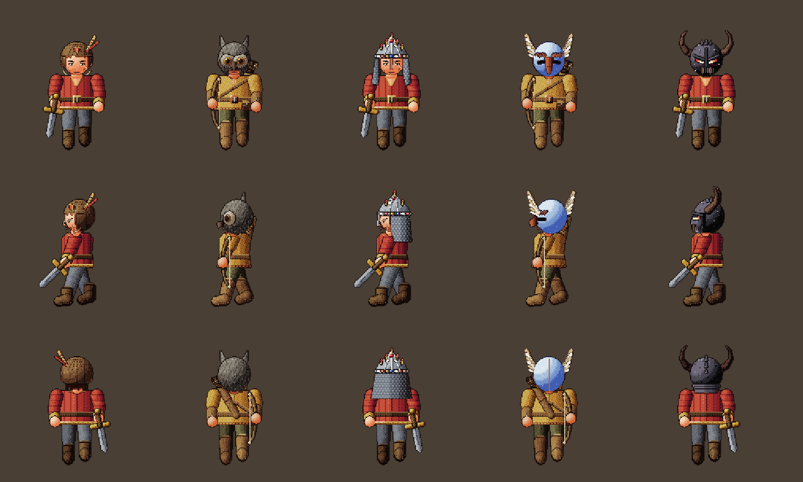

**Armaduras mágicas**: Gibão do Aventureiro (bandoleira, corda, mapa e bolsa de carga), Couraça do Leão (cabeça de
leão e juba nos ombros), Cota Élfica (malha prateada com folhas e faixa verde), Armadura de Placas Anã (rosto de rei
anão, barba trançada e runas), Escamas do Dragão Vermelho (brasa entre as escamas, chama no peito e asinhas):

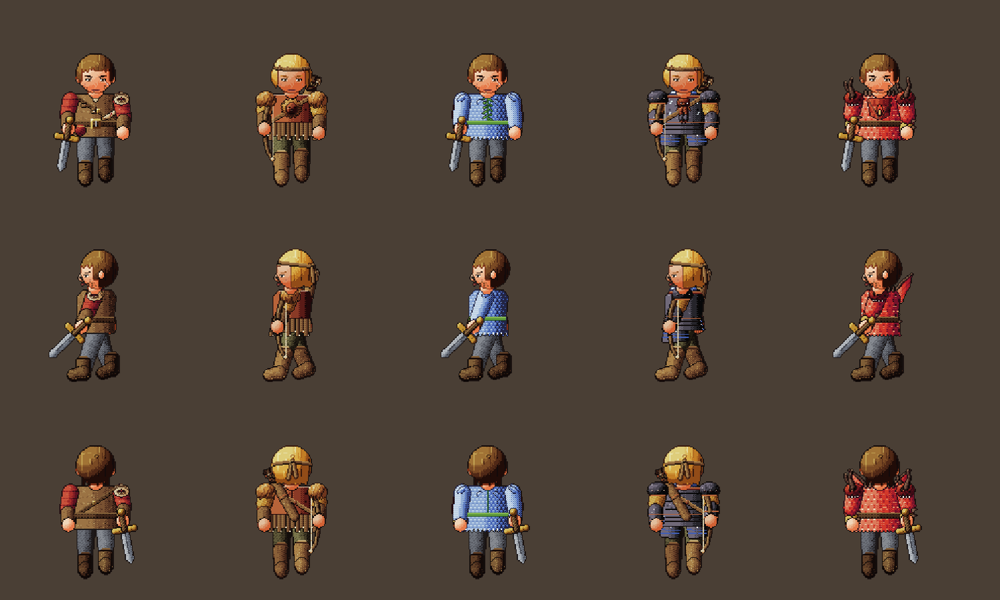

## 8. Lote 3 desenhado

Os 10 machados, comuns e mágicos, no cavaleiro. Os de uma mão são segurados com a cabeça para cima, ao lado do
corpo; os de nível 5 (Grande machado do dragão e Ruína dos Gigantes) são de duas mãos, do chão até acima da cabeça.

**Machados comuns**: machadinha de pedra amarrada, meia-lua de bronze com furos, lâmina dupla nórdica com corvo,
asa de grifo de mithral em cabo branco, asas de dragão com crânio:

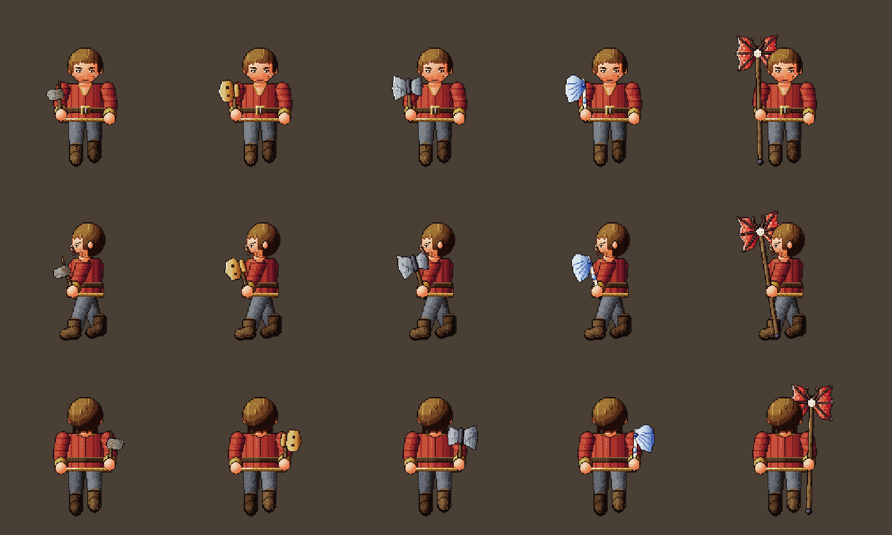

**Machados mágicos**: Machado do Berserker (mandíbula de urso, olhos em brasa, pelo no cabo), Machado Uivante
(cabeça de lobo uivando, vento), Machado dos Reis Anões (lâmina dupla de ferro, rosto de rei em ouro, runas e
anéis), Machado da Tempestade (raio encravado e faíscas), Ruína dos Gigantes (pedra e ferro, maior que o herói, com
dentes de gigante amarrados):

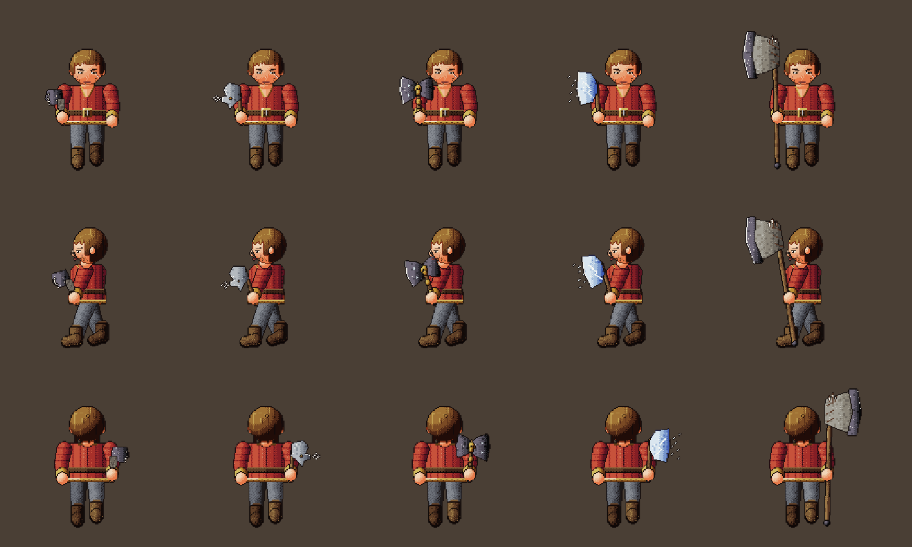

## 9. Ordem de execução

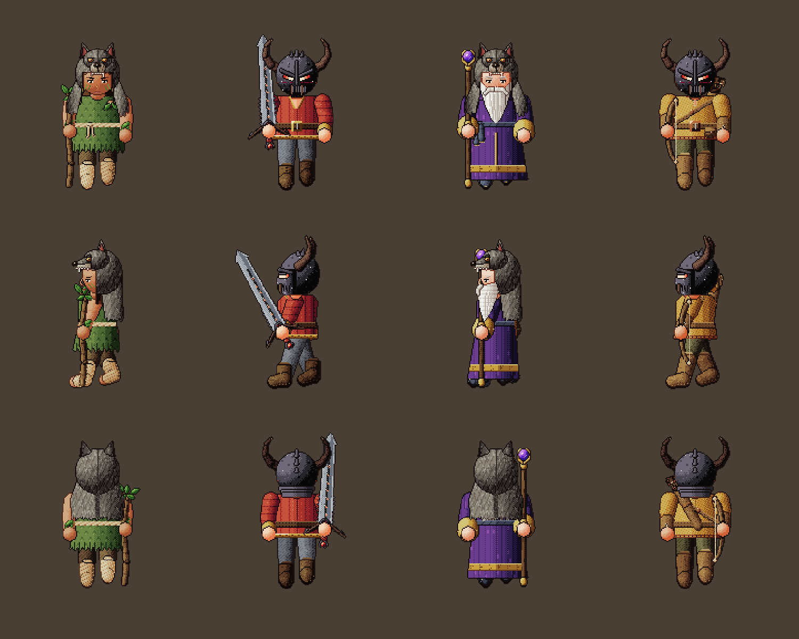

1. **Piloto** ✅: Capuz do Lobo, Elmo do Demônio e Lâmina do dragão.
   **Lote 1** ✅: espadas, elmos de guerra e armaduras de guerra comuns (seção 6).
   **Lote 2** ✅: os mágicos dessas 3 famílias (seção 7).
   **Lote 3** ✅: machados (seção 8).
   **Lote 4**: arcos e bestas (paladino).
2. Armas (o que mais aparece), depois armaduras e mantos, capacetes, botas, calças e escudos.
3. Ícones de 32×32 a partir de cada desenho pronto.
4. Integração no jogo atrás da opção "Arte nova (beta)", com o teste `arte.ts` conferindo cada item.
