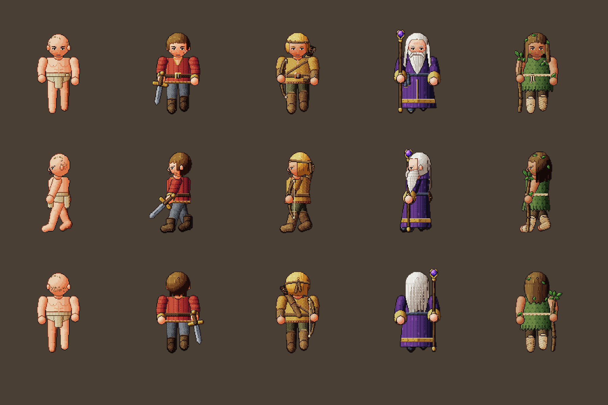
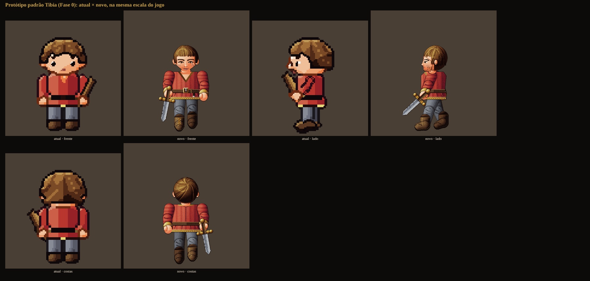
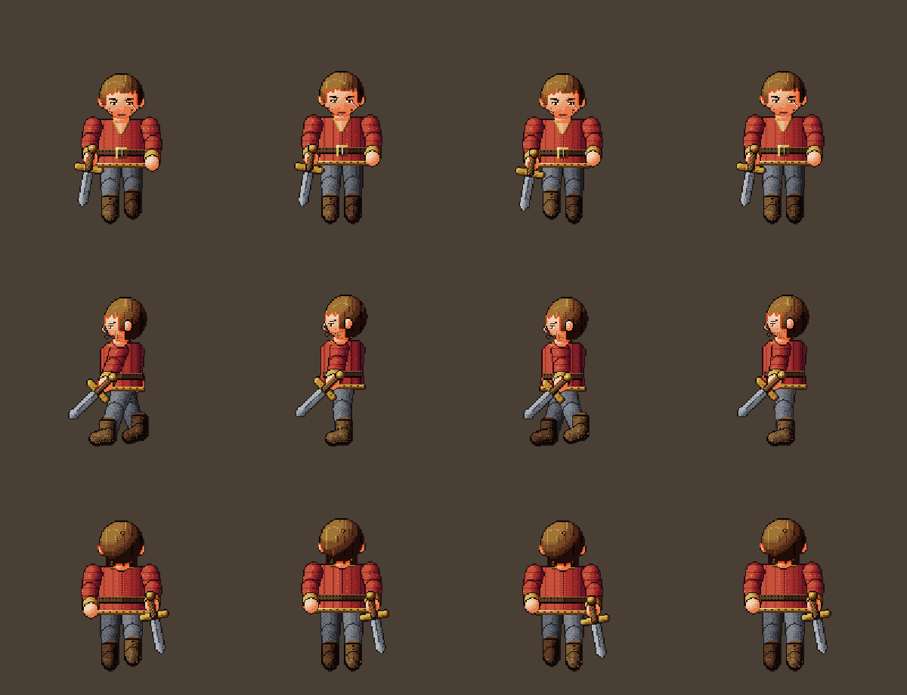
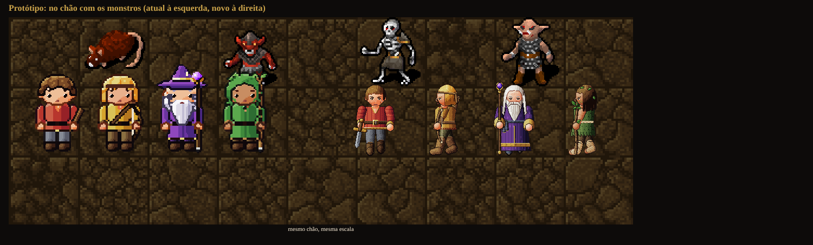
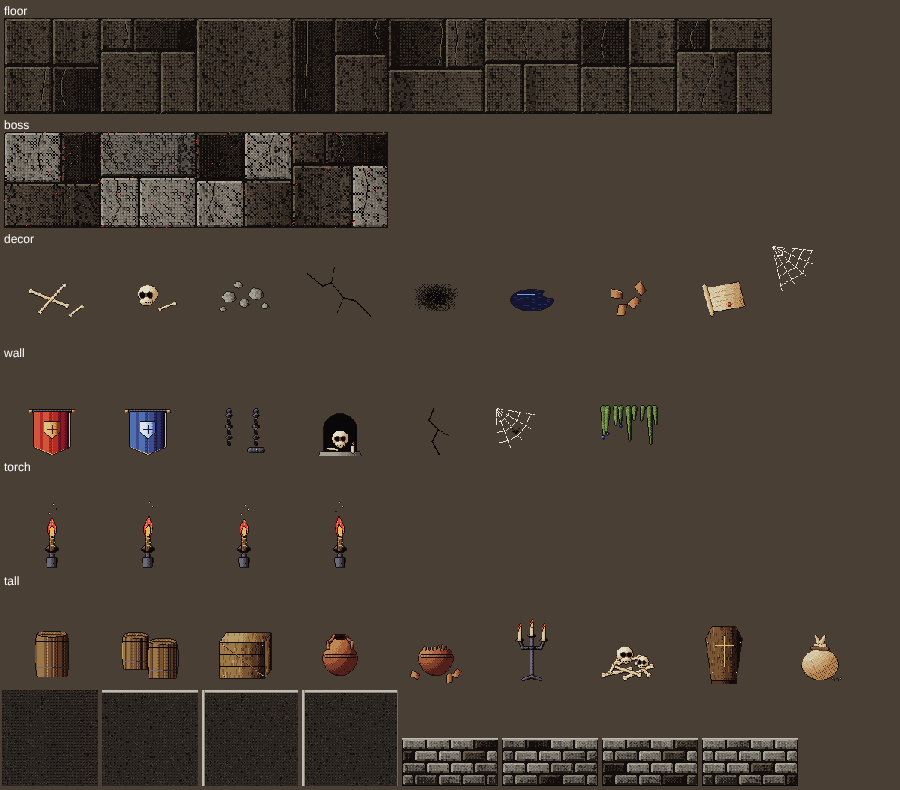
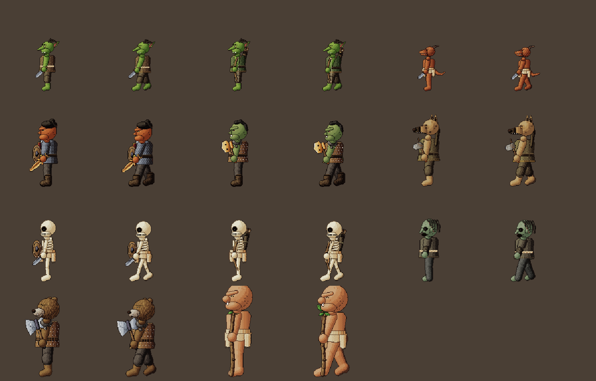
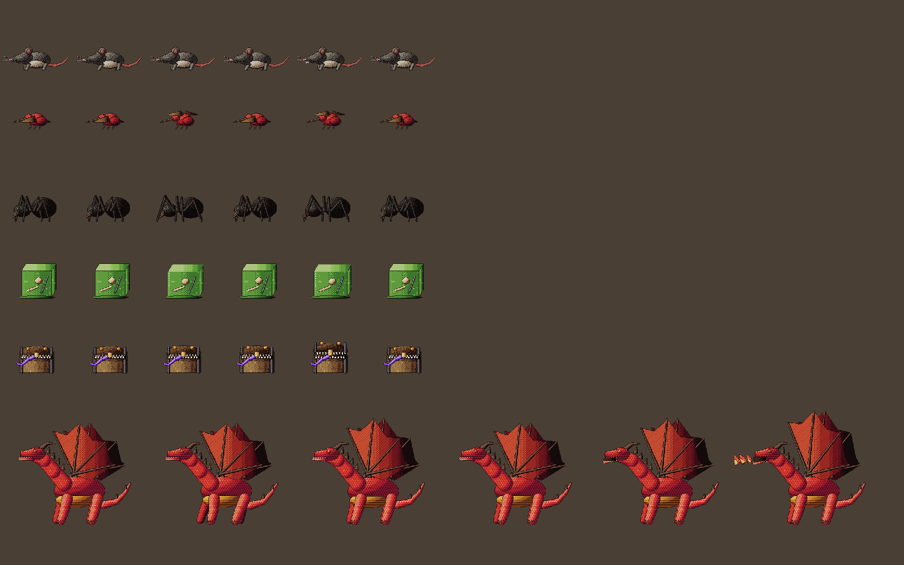
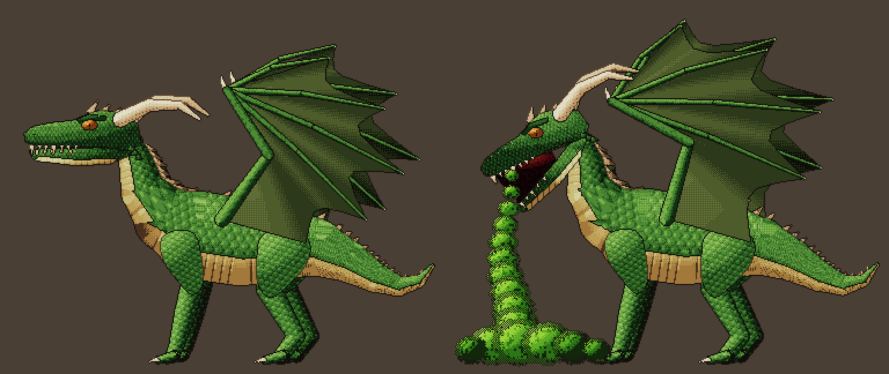
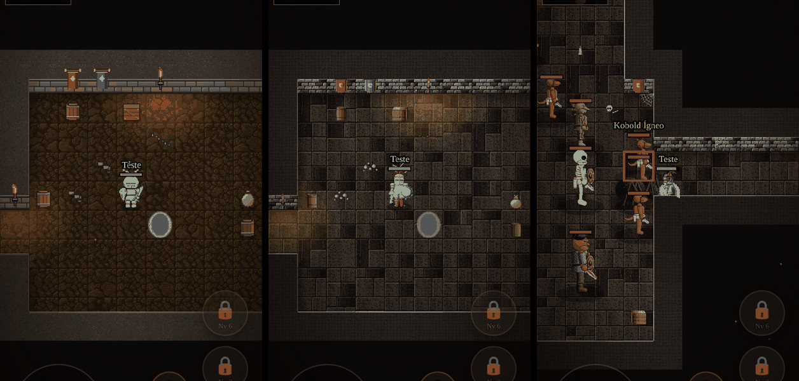
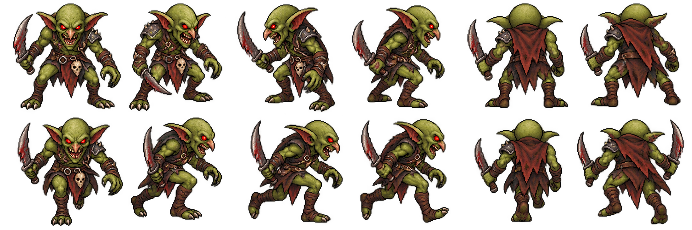

# Padrão de arte inspirado no Tibia — especificação

Referência de estilo para heróis, monstros e mapas. Complementa `docs/ARTE_HEROIS_PLANO.md` (que trata do
equipamento vestido) e vale para toda arte nova ou refeita. Nada aqui muda regra de jogo: é só cliente.

**Limite legal:** os sprites do Tibia são da CipSoft. Estudamos o **padrão** (grade, perspectiva, proporção,
luz, paleta, organização do mapa); não copiamos, traçamos nem recolorimos sprite nenhum.

---

## 1. Diagnóstico da arte atual (galeria `arte.html`)

| Área | Como está | Por que não lembra o Tibia |
|---|---|---|
| Proporção dos heróis | Cabeça de 13 px num corpo de 36 (≈36% da altura), cabeça mais larga que os ombros | É proporção *chibi*, leitura de RPG Maker. No Tibia a cabeça tem ≈25–28% e os ombros são mais largos que ela |
| Rosto | Olhos de 2 px com branco, boca desenhada | Rosto "fofo" e grande. No Tibia o rosto é quase só sombra: olhos de 1 px escuro, sem boca |
| Pose | Frente rígida e simétrica, braços colados, pés juntos | Tibia mostra peso: pernas afastadas, ombro de lá aparecendo, arma para fora da silhueta |
| Pintura | Luz calculada pela forma + Scale2x + bandas automáticas | Superfície lisa, "plástica". Tibia é pintado à mão: textura de material (malha, couro, pelo), dither, contorno quase preto |
| Cor | Cada classe é um bloco de uma cor (vermelho, amarelo, roxo, verde) | Tibia usa 4 zonas de cor por personagem (cabeça, tronco, pernas, detalhe) com tons médios e terrosos |
| Monstros | Três estilos lado a lado: pack Dungeon Crawl (CC0), arte própria do Pântano, orcs/ogros do Kosaradius | A tela mistura dialetos: sombra projetada em uns, sem em outros; contornos e saturação diferentes |
| Paredes | Face de 16 px (meio tile), tampa lisa | No Tibia a parede tem 1 tile de altura visível e "fecha" o corredor; é ela que dá a sensação de masmorra |
| Chão | Uma textura de terra por mapa, decoração esparsa e solta | Tibia tem variações de piso, **bordas** de transição entre terrenos e muito objeto pequeno agrupado |

O que já está bom e fica: grade de 32 px por tile, luz de cima à esquerda, decoração com variação por hash,
tochas com poça de luz na Cripta, equipamento visível (é decisão de jogo do Kusa, não existe no Tibia).

---

## 2. O que define o padrão Tibia

### 2.1 Grade e escala
- **32×32 px por tile**, 1 pixel de arte = 1 pixel na escala base. Tudo na tela tem a mesma densidade.
- Ampliação só **inteira e sem filtro** (vizinho mais próximo). Não existe pixel "meio tamanho".
- Objeto ou criatura grande ocupa 2 ou 4 tiles (32×64, 64×32, 64×64), ancorado no **tile de baixo à direita**
  e crescendo para cima e para a esquerda.

### 2.2 Perspectiva (oblíqua fixa)
- O chão é visto de cima. Tudo que tem altura (parede, pessoa, barril, árvore) é desenhado **em pé**, mostrando
  a face sul, e "sobe" para o tile de cima.
- Personagens e criaturas são desenhados com **deslocamento de ≈8 px para cima e para a esquerda** em relação
  ao tile. Isso cria a profundidade característica sem sombra projetada.
- **Não há sombra no chão** debaixo dos personagens. A profundidade vem do deslocamento e da ordem de desenho
  (de cima para baixo, da esquerda para a direita).

### 2.3 Luz, contorno e pintura
- Luz de **cima à esquerda**; sombra embaixo à direita (consenso da comunidade de *spriting*).
- **Contorno escuro** (quase preto, levemente quente) em volta da figura; linhas internas mais claras que o
  contorno externo.
- **3 a 5 tons por material**, sem degradê. Textura vem de padrão de pixel: malha em xadrez de 2 tons, couro
  com pontos, pelo com traços curtos, pedra com manchas.
- Saturação média e cores terrosas; cor viva só em acento (gema, olho, fogo, magia).

### 2.4 Personagens (outfits)
- Corpo de adulto atarracado: cabeça ≈1/4 da altura, ombros largos, mãos e pés grandes.
- **4 zonas de cor** (cabeça, primária, secundária, detalhe), aplicadas por máscara sobre o sprite em tons de
  cinza. A paleta do Tibia tem 133 cores (19 matizes × 7 tons). A identidade de quem é quem vem do outfit e
  dos *addons* (peças extras, ex.: chapéu, capa, arma nas costas).
- 4 direções, caminhada animada (8 quadros nos outfits modernos), alguns com animação parado.
- Ação (golpe, magia) quase não muda a pose: quem conta a ação é o **efeito** (projétil, explosão, número de dano).

### 2.5 Criaturas
- Mesmo dialeto dos personagens: mesma luz, contorno e densidade.
- Tamanho conta a ameaça: rato e inseto em 32×32; dragão e demônio em 64×64 (4 tiles).
- Silhueta reconhecível em preto; **2 cores dominantes + 1 acento**.
- Ao morrer, deixam **cadáver** que se decompõe em estágios (fresco → podre → ossos) e some. É uma das marcas
  visuais do jogo e enche o mapa de história da luta.

### 2.6 Mapa
- Piso com várias variações do mesmo terreno, sorteadas.
- **Bordas**: entre dois terrenos (grama e terra, terra e água) entram peças de transição (lados, cantos de
  dentro e de fora), em vez de corte reto de tile.
- Paredes com **1 tile de altura visível** e espessura; cantos e pontas próprios; tochas e adornos presos nelas.
- Muita "tralha" pequena (pedras, ossos, poças, teia, caixas, barris), sempre **agrupada** perto de paredes e
  cantos, nunca espalhada por igual.
- Escuridão ambiente com **raios de luz** (tocha, personagem, magia) nas áreas subterrâneas.

---

## 3. Especificação para o Kusa

### 3.1 Regras globais (valem para tudo)

| # | Regra | Valor |
|---|---|---|
| G1 | Densidade | **128 px de arte por tile** (4× o Tibia; decidido no protótipo, ver Fase 0). É o limite em que 1 pixel de arte ainda vira ≈1 pixel de tela no celular. A arte de 32 px por tile que fica entra ampliada 4× até ser refeita |
| G2 | Refinamento | Sem Scale2x nem luz automática na arte nova: tons e textura pintados na grade. O `refine.ts` fica só para a arte antiga até ser trocada |
| G3 | Luz | Cima à esquerda, em todos os sprites e na decoração |
| G4 | Contorno | Externo `#1a1210` (1 px, igual em todas as figuras); interno no tom 0 do material vizinho |
| G5 | Tons | 4 por material (luz, base, sombra, fundo); 5 só em metal (com brilho) |
| G6 | Sombra projetada | Nenhuma no sprite. Se precisar destacar a figura do chão, uma elipse única do motor, igual para todos |
| G7 | Saturação | Base terrosa (S ≤ 55%); acima disso só gema, olho, fogo, magia e efeito |
| G8 | Ancoragem | Pés/base no tile; o que passa de 32 px sobe e vai para a esquerda (deslocamento de 6–8 px) |

### 3.2 Heróis

| # | Item | Hoje | Novo padrão |
|---|---|---|---|
| H1 | Altura do corpo | 36 px no quadro de 48 | 30–32 px de corpo (pés à cabeça), quadro de 48 para sobra de arma e chapéu |
| H2 | Cabeça | 13 px (≈36%) | 8–9 px de altura, ≈27% do corpo; largura menor que a dos ombros |
| H3 | Ombros | Mais estreitos que a cabeça | 12–14 px de largura, a parte mais larga da figura |
| H4 | Rosto | Olho de 2 px com branco, boca | Olho de 1 px escuro, sobrancelha/sombra de 1 px, sem boca; barba e cabelo fazem a expressão |
| H5 | Pose parada | Simétrica, pés juntos | Pés afastados 2–3 px, mão da arma à frente, quadril levemente virado; de lado, ombro de lá visível |
| H6 | Vista | Frente pura | Leve visão de cima: topo da cabeça e dos ombros aparecem (1–2 px), sola do pé não |
| H7 | Cor da classe | Bloco de uma cor | 4 zonas fixas por classe: **cabeça** (cabelo/capuz), **primária** (tronco), **secundária** (pernas), **detalhe** (cinto, botas, debrum). Tons médios |
| H8 | Equipamento | Repinta a peça inteira no material | Mantém o sistema atual de item vestido, mas a peça cobre a sua zona e deixa as outras zonas da classe à mostra (ex.: armadura cobre a primária; a secundária e o detalhe continuam na cor da classe) |
| H9 | Textura | Lisa | Cota de malha em xadrez, couro com pontos, tecido com dobra vertical de 1 px, metal com 1 brilho de 1–2 px |
| H10 | Caminhada | 3 quadros | 4 quadros (contato, passagem, contato, passagem) com balanço de 1 px |
| H11 | Ação | Herói parado + efeito | Continua assim (padrão Tibia). Opcional: 1 quadro de golpe/conjuração por classe |

Zonas sugeridas por classe (tons médios, ajustar no protótipo):

| Classe | Cabeça | Primária | Secundária | Detalhe | Marca que nenhum item cobre |
|---|---|---|---|---|---|
| Cavaleiro | castanho | vermelho-tijolo | cinza-aço | couro escuro | cicatriz, tabardo vermelho por cima da armadura |
| Paladino | loiro | ocre | marrom-oliva | couro claro | aljava nas costas, faixa na testa |
| Feiticeiro | branco (barba) | violeta escuro | cinza-azulado | dourado | barba longa, gola alta |
| Druida | castanho com folhas | verde-musgo | marrom | cobre | broche de folha, pintura no rosto |

Bônus: as 4 zonas são exatamente o que um **cosmético de cor** troca (`buy_cosmetic`), como o outfit do Tibia.

### 3.3 Monstros

| # | Regra |
|---|---|
| M1 | Um dialeto só. Os sprites do pack Dungeon Crawl são trocados por arte própria no padrão, começando pelos mais vistos (rato, goblin, esqueleto, orc, zumbi) |
| M2 | Tamanho por papel: comum 32×32 (cabe num tile); mini-boss 48×48; boss 64×64. Base no tile, sobe para cima e esquerda |
| M3 | Silhueta testada em preto: tem que dar para dizer o que é sem cor |
| M4 | 2 cores dominantes + 1 acento (olho, arma, veneno) |
| M5 | Mesmo contorno, luz e tons dos heróis (G3–G5); sem sombra própria no sprite |
| M6 | Parado com respiração de 2 quadros; andar de 2–4 quadros; golpe de 1–2 quadros |
| M7 | **Cadáver** em 3 estágios (fresco, podre, ossos) por família de corpo (humanoide, fera, inseto, morto-vivo), só visual no cliente |
| M8 | Variações do mesmo bicho (arqueiro, capitão, xamã) mudam **um acessório** (arco, elmo, cajado), não o corpo |

### 3.4 Mapas

| # | Regra |
|---|---|
| P1 | Piso: 4–8 variações por terreno + 1 detalhe raro (≈1 a cada 20 tiles), sorteados por `hash` |
| P2 | Bordas de transição entre terrenos (lados, cantos de dentro e de fora: 12 peças por par) |
| P3 | Parede com 32 px de face (hoje `WALL_RISE = 16`), tampa com espessura, ponta e canto próprios |
| P4 | Decoração em **grupos**: 60% do chão limpo, 30% com detalhe pequeno, 10% com objeto grande; grupos encostados em parede e canto |
| P5 | Paleta de 8–12 cores base por mapa (Cripta fria e cinza, Pântano verde-oliva, Deserto ocre), com monstros e heróis contrastando com ela |
| P6 | Luz: escuridão ambiente nos mapas subterrâneos, raio de luz no herói e nas tochas (a Cripta já faz; estender) |
| P7 | Marcas de luta: sangue, cadáver (M7) e item no chão ficam por um tempo e somem |

### 3.5 Legibilidade no celular (não negociável)
- O tile tem ≈46 px CSS em retrato. Todo detalhe de 1 px precisa ser **acento**, não informação: a classe e o
  monstro têm que ser reconhecíveis pela silhueta e pelas zonas de cor na tela real (`tamanho real` do provador).
- Testar sempre em 412×915 e 915×412 (Jogar deitado).

---

## 4. Checklist de aceitação de um sprite
- [ ] Densidade de G1, sem refinamento automático (Scale2x).
- [ ] Contorno `#1a1210`, luz de cima à esquerda, 4 tons por material.
- [ ] Silhueta reconhecível em preto, no tamanho real do celular.
- [ ] Herói: cabeça ≈27% do corpo, ombros mais largos que a cabeça, 4 zonas de cor visíveis.
- [ ] Monstro: 2 cores + 1 acento, tamanho conforme o papel (M2), sem sombra própria.
- [ ] Nenhuma cor com saturação alta fora de acento.
- [ ] Lado a lado com 3 sprites já aprovados: parece do mesmo jogo.
- [ ] Nada traçado ou recolorido de sprite do Tibia.

---

## 5. Plano de execução

| Fase | Entrega | Custo | Impacto |
|---|---|---|---|
| 0. Protótipo | Cavaleiro sem equipamento no novo padrão (frente, lado, costas, 4 quadros), no provador ao lado do atual | baixo | decide se o padrão serve antes de refazer tudo |
| 1. Manequim | Novo esqueleto (`hero/rig.ts`) com as proporções H1–H6 e as 4 zonas; corpos das 4 classes | médio | resolve a maior parte do incômodo com os heróis |
| 2. Itens | Reencaixar armaduras, elmos e armas no manequim novo (o teste `arte.ts` aponta o que sair do quadro) | alto (≈3.300 linhas em `art/hero/`) | equipamento coerente com o corpo novo |
| 3. Monstros comuns | Trocar os 5 mais vistos do pack CC0 + cadáver (M7) | médio | acaba a mistura de estilos no começo do jogo |
| 4. Mapas | Parede de 32 px (P3), bordas (P2), grupos de decoração (P4) | médio | sensação de masmorra "tibiana" |
| 5. Resto | Demais monstros e bosses no padrão | alto | consistência total |

### Fase 0: protótipo (feito)

Código em `apps/client/src/art/proto/tibiaHero.ts`, só na galeria (`arte.html`, seções "Protótipo"); o jogo
continua com `heroes.ts`. Cavaleiro sem equipamento, frente, lado e costas, 4 quadros de caminhada, com 3 variações
de cor de exemplo.

- **1ª versão (32 px por tile, grades de letras):** proporção certa, mas pouco detalhe. Recusada: "precisa de
  mais detalhe fino, pixel menor".
- **2ª versão (64 px por tile):** formas com volume (esfera, cilindro, membro) e detalhe à mão. Recusada:
  "ainda mais detalhes, dobre mais uma vez".
- **3ª versão (128 px por tile): ESCOLHIDA.** Quadro 192×192, corpo de 128 px. Formas (esfera, cilindro,
  membro) amostradas na resolução final e detalhe pixel a pixel nela: olho com íris e brilho, barba por fazer,
  mechas, costura do gibão, cinto com furos e fivela, sarja da calça, bota com cadarço e sola, espada com sulco e
  cabo trançado. É o código que está em `tibiaHero.ts`.
- **4ª versão (384 px por tile): descartada.** Detalhe de ilustração (mechas em traços, íris com anel, cadarço
  com ilhoses), mas acima do que o celular mostra (a arte seria reduzida ≈3×), ≈16 MB de memória de vídeo por herói
  e longe do padrão Tibia. Fica no histórico do git (commit "Protótipo da arte em 384 px por tile") como referência
  para retratos de menu, se um dia fizerem falta.

**Decisão:** o padrão é o da 3ª versão, 128 px por tile. Consequências para as próximas fases:
- **Fase 1** (manequim e classes) e **Fase 2** (itens vestidos) seguem em 128 px, com o desenho por formas da 3ª
  versão. Textura de 192×192 por quadro: ≈1,7 MB por herói com 12 quadros, aceitável para 4 heróis.
- **Fases 3 a 5** (monstros e mapas) também passam a 128 px por tile; até lá, a arte de 32 px entra ampliada e
  fica mais grossa ao lado dos heróis.
- Ajustes pendentes do protótipo: o perfil de lado (rosto pequeno perto do cabelo).

#### Corpo base e as 4 classes

O protótipo agora tem um **corpo base** (só de tanga de linho na cintura, careca, descalço, sem arma) e cada
classe é um **kit** vestido sobre ele (`KITS` em `tibiaHero.ts`). Cada parte do corpo é desenhada e logo coberta
pelo que o kit veste ali (perna → calça → bota; braço → manga → mão), então o mesmo esqueleto e a mesma caminhada
servem às 4 classes e ao corpo nu. Na Fase 2 os itens entram como mais uma camada desse mesmo caminho.

| | Corpo base | Cavaleiro | Paladino | Feiticeiro | Druida |
|---|---|---|---|---|---|
| Cabelo e rosto | careca | castanho curto, barba por fazer, cicatriz | loiro médio, faixa de couro na testa | branco comprido com entradas, barba longa e bigode, rugas | castanho solto repartido, folhas no cabelo, pintura verde |
| Roupa de cima | peito nu | gibão acolchoado, gola em V | túnica de linho, gola com cordão | manto de veludo até os pés, gola alta, abertura dourada | túnica de folhas até o joelho, barra recortada, broche de folha |
| Mangas | braço nu | acolchoadas, punho bordado | curtas + braçadeira de couro amarrada | de sino, barra dourada larga | braço nu com cipó e folhas |
| Cintura | tanga | cinto com fivela | cinto com fivela e bolsinha | faixa com nó e franja | corda trançada com nó |
| Barra | — | dourada com losangos | dois filetes | dourada com runas | pontas de folha com nervura |
| Pernas e pés | descalço | calça + bota com cadarço | calça + bota de montaria com fivela | sapatilha de ponta virada | bermuda + faixas de linho e pé descalço |
| Arma | — | espada de treino | arco simples (corda, empunhadura, pontas de chifre) | cajado com gema roxa e garras douradas | galho torto com folhas |
| Costas | — | — | aljava com flechas e tira cruzada | cabelo até o meio das costas | cabelo até os ombros |

Os chapéus antigos do feiticeiro (pontudo) e do druida (capuz) saíram do corpo: viram itens de capacete, como
no catálogo. A classe é reconhecida pela silhueta (manto comprido, arco e aljava, túnica de folhas) e pelas cores.

### Riscos
- **Retrabalho do sistema de itens:** mudar o manequim obriga a reencaixar cada item. Mitigação: manter a API de
  `rig.ts` (mesmos nomes de pontos e máscaras) e mudar só as medidas.
- **Herói menor na tela:** cabeça menor pode perder leitura no celular. Mitigação: a fase 0 é validada no tamanho real
  antes de seguir; se precisar, o herói continua em `HERO_SCALE` > 1.
- **Custo de arte por código:** pintar textura à mão em grade de código é lento. Alternativa a avaliar: desenhar no
  Aseprite/Pixelorama no padrão deste documento e carregar como PNG, mantendo por código só o recolorir das zonas.

### Piloto da Cripta (Fases 3 e 4, só com a Arte nova (beta))

A Cripta inteira no padrão novo, para medir no celular o que custa estender o padrão aos mapas e aos monstros
antes de fazer os outros 3 cenários. Tudo atrás da opção **Arte nova (beta)**; desligada, nada muda.

- **Cenário** (`art/proto/crypt.ts`): lajes com bisel e juntas com musgo, covil queimado do dragão, tampa lisa e
  face de tijolos das paredes, os 15 enfeites do chão, os 7 da parede, a tocha (4 quadros) e os 9 móveis. São os
  mesmos quadros da arte antiga (`cryptDecor.ts`, `walls.ts`), 4× maiores: o mapa troca as texturas e desenha em
  1/4 de escala. A sombra das paredes, a luz das chamas e a poeira continuam as antigas. Tudo sai em ≈0,15 s.
- **Monstros humanoides** (`MONSTER_KITS` em `tibiaHero.ts`): goblin, goblin arqueiro, kobold (com cauda),
  hobgoblin, orc, gnoll, esqueleto, esqueleto arqueiro, zumbi, bugbear e ogro usam o corpo, a caminhada e o
  equipamento dos heróis com a cabeça da espécie, a cor da pele, o tamanho e a grossura dos membros. No jogo os
  monstros só aparecem de lado (o jogo espelha), então basta a vista de perfil.
- **Bichos** (`art/proto/beasts.ts`): rato, stirge, aranha gigante, cubo gelatinoso (com ossos e uma espada
  dentro), mímico (e o baú do disfarce) e o dragão jovem, este num quadro 2× maior.
- **Dragão verde** (`art/proto/dragon.ts`): pescoço, tronco e cauda são um tubo só ao longo da coluna, com luz de
  cilindro e escamas que seguem a curva do corpo (borda solta virada para a cauda); barriga de placas claras
  atravessadas; espinhos de marfim nas costas, com membrana no pescoço (a crista); cabeça comprida com crista, chifres
  de marfim para trás, sobrancelha pesada, olho âmbar de pupila em fenda e dentes de tamanhos diferentes; coxa e
  ombro musculosos, pés de três dedos com garras; asas de morcego com braço, polegar com garra, quatro dedos e a
  membrana em arcos. Parado respira; anda com as patas em diagonal; a mordida recua e dá o bote; o sopro é gás
  venenoso, que desce da boca e se espalha no chão. Cada quadro leva ≈0,1 s num computador.
- Cada monstro tem os clipes parado, andar, ataque e magia (4 quadros cada); a barra de vida fica logo acima da
  cabeça de cada um. Os humanoides têm pose própria em cada quadro (`monsterPose`): parado respira (o peito sobe e
  desce e a arma balança), o golpe tem preparo com a arma lá atrás, o golpe com o tronco inclinado para a frente,
  o fim do movimento e a volta; o arqueiro puxa a corda e solta, o zumbi cai por cima com os dois braços e a magia
  ergue os braços. Monstros e heróis vão na mesma escala (`NEW_ART_ZOOM`).
- Cuidado: a folha animada é desenhada aos poucos, então nada pode registrar outra textura com a mesma chave antes
  (o retrato parado ocupava a chave e o monstro ficava sem animação e no dobro do tamanho).
- **Custo:** todos os monstros da Cripta somam ≈3 s de desenho num computador (o dragão sozinho, ≈1,4 s). Para
  não travar o menu nem a hunt, a folha de cada um é desenhada aos poucos, um quadro a cada 30 ms, os menores
  primeiro; um monstro que aparece antes de ficar pronto termina na hora. Se no celular ainda pesar, o próximo
  passo é desenhar no build e carregar como PNG.

### Goblin a partir de arte de referência

O goblin da arte nova deixou de ser desenhado por código: vem da arte de referência em `docs/arte/goblin-referencia.png`
(12 figuras: parado e andando em 6 ângulos). O script `apps/client/scripts/goblinSprites.py` recorta cada figura,
reduz para a escala da arte nova (128 px por tile, o goblin com ~110 px de altura), alinha os pés na linha dos outros
monstros e grava a folha `apps/client/src/art/proto/goblin.png` (12 quadros de 192 px). `art/proto/goblinArt.ts` monta
os clipes do jogo, de perfil e olhando para a esquerda: parado (o perfil respirando), andar (as três passadas), golpe
(um bote montado com a passada, porque a referência não tem golpe) e magia (o fôlego). Frente e costas ficam prontas
para as 3 vistas. O goblin arqueiro continua desenhado por código.

Para refazer depois de trocar a referência:
`python3 apps/client/scripts/goblinSprites.py docs/arte/goblin-referencia.png apps/client/src/art/proto/goblin.png`.

### Chão do Pântano das Ruínas com a arte do agente (substituído)

O chão do Pântano das Ruínas chegou a vir das imagens do agente de arte (`pantanoTexturas.py`, `wetlandHd.ts`). Com a
regra de que **cenário é sempre código** (`docs/CENARIOS_PLANO.md`), o mapa inteiro passou a ser pintado em 128 px por
código (fase 1b) e essas texturas saíram do jogo e do repositório (ficam no histórico do git). A arte por IA ficou só
para os inimigos.

### Sapo gigante a partir das folhas geradas por IA

O sapo do Pântano das Ruínas vem de duas folhas geradas por IA e aprovadas (`docs/arte/pantano-das-ruinas/frog-A.png`,
parado e andando em 6 ângulos, e `frog-B.png`, de perfil: andar, bote, língua e morte). O script
`apps/client/scripts/frogSprites.py` tira o xadrez desenhado no fundo, separa cada figura pela mancha conectada (a
língua passa por cima do quadro vizinho), põe as duas folhas na mesma escala e grava `art/proto/frog.png` (27 figuras
de 352 px; o quadro é largo para a língua esticada caber). `art/proto/frogArt.ts` monta os clipes.

É o primeiro monstro com mais movimentos que os 4 de sempre (`MonsterAnim.extra` e `strike` em `bestiary.ts`):

- a habilidade (Língua) toca a língua esticando, não o golpe;
- ao morrer, o cadáver toca a morte desenhada em vez de tombar;
- andando para cima ou para baixo, mostra as costas ou a frente (parado também fica na última vista).

Para refazer: `python3 apps/client/scripts/frogSprites.py docs/arte/pantano-das-ruinas/frog-A.png
docs/arte/pantano-das-ruinas/frog-B.png apps/client/src/art/proto/frog.png`.

### Rei Bullywug a partir das folhas do Runway

O boss do Pântano das Ruínas vem de duas folhas geradas no Runway e aprovadas, com fundo magenta chapado
(`docs/arte/pantano-das-ruinas/bullywug-A.png`, turnaround 2×6, e `bullywug-B.png`, ação 4×4: andar, golpe de lança,
bote saindo da lama e morte). As duas olham para a direita. O script `apps/client/scripts/bullywugKingSprites.py` tira o
magenta e a borda rosada do antialias, separa cada figura pela mancha conectada (os respingos de lama vão para a figura
mais perto), espelha tudo para a esquerda, põe as duas folhas na mesma escala (~1,6 vez a altura de um herói) e grava
`art/proto/bullywugKing.png` (28 figuras de 448 px). `art/proto/bullywugKingArt.ts` monta os clipes:

- o andar usa os três perfis andando da folha A (o andar da B larga a lança);
- `strike` por habilidade: o Bote da Lama toca o bote saindo da lama ao reaparecer; a Estocada e o Chamado, o golpe;
- a morte desenhada, e frente e costas andando (de frente o passo não é espelhado: a lança trocaria de mão).

Na arte antiga, o Rei é o bullywug do pack em tamanho de boss.

Para refazer: `python3 apps/client/scripts/bullywugKingSprites.py docs/arte/pantano-das-ruinas/bullywug-A.png
docs/arte/pantano-das-ruinas/bullywug-B.png apps/client/src/art/proto/bullywugKing.png`.
