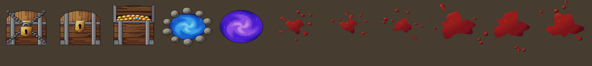
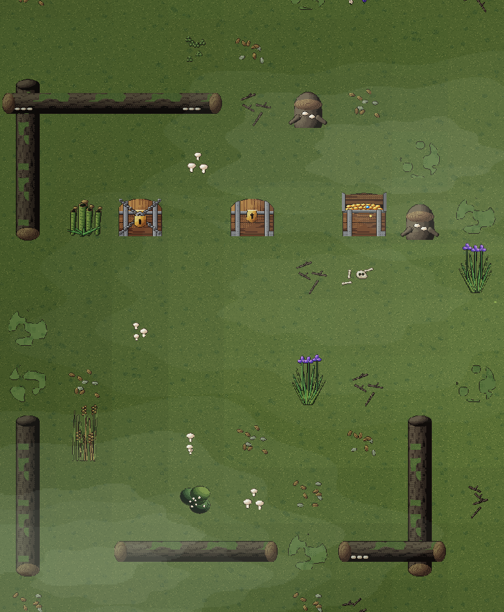
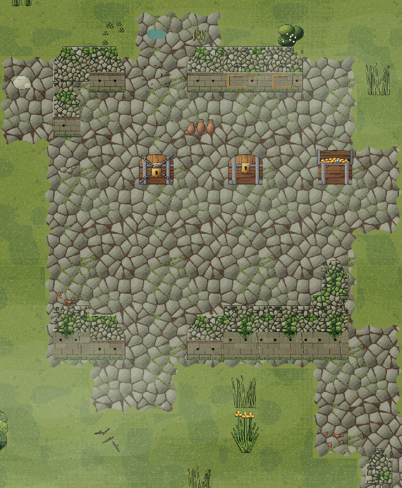
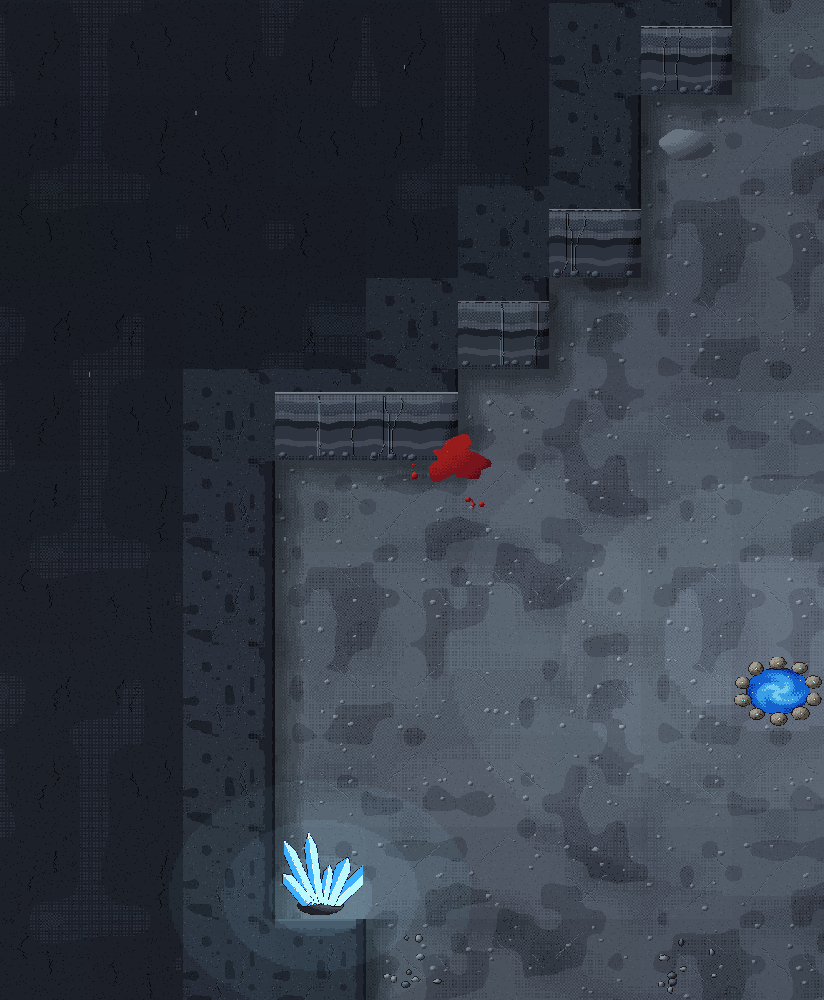
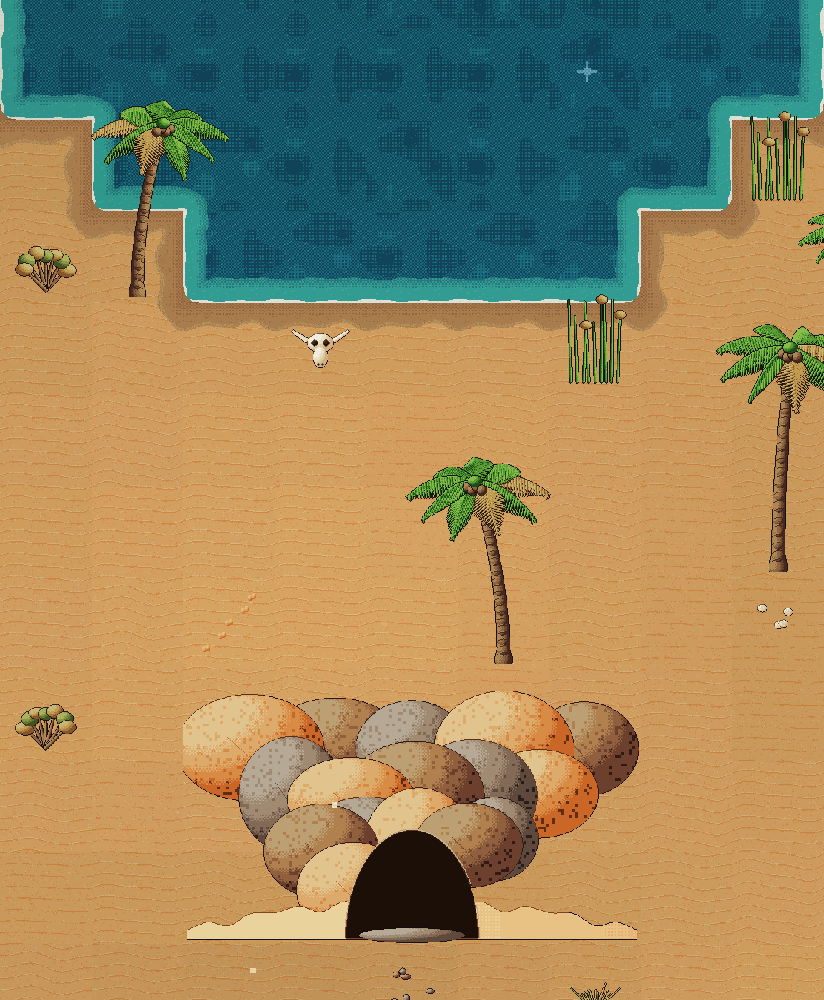

# Padronização dos cenários — plano

Regra decidida: **todo cenário é desenhado por código, em 128 px por tile**, no padrão de `docs/ARTE_TIBIA.md`
(G1–G8 e P1–P7). **Inimigos** vêm de arte gerada por IA, em outra frente de trabalho (ver "Divisão com a frente dos
inimigos"). Nada aqui muda regra de jogo: é só o cliente. O gerador de cada mapa (`packages/shared`) e o servidor não
mudam, então `RULES_VERSION` não muda.

---

## 1. Onde estamos

| Mapa | Hoje | Falta |
|---|---|---|
| 🌬️ Dunas Cantantes, 🪨 Mesas de Solária | ✅ 128 px por código (`dunesMap.ts`, `art/duneArt.ts`) | — |
| 🌳 Bosque Velho, 🍄 Coração da Mata | ✅ 128 px por código (`forestMap.ts`, `forestPlan.ts`, `art/forestArt.ts`) | — |
| 🏛️ Portões do Império | ✅ 128 px por código (`gatesMap.ts`, `art/empireArt.ts`, `art/empireMonuments.ts`) | — |
| 🏚️ Cripta | ⚠️ 128 px por código (`art/proto/crypt.ts`), mas só com **Arte nova (beta)** | tirar da opção beta e apagar a versão de 32 px |
| 🌿 Pântano das Ruínas | ⚠️ chão em 128 px feito com **imagens de IA** (`art/proto/pantano/`, `wetlandHd.ts`); lajes, árvores, enfeites e ruínas em 32 px | **tudo**: refazer em código, chão incluído |
| 🐸 Pântano do Kosaradius | ❌ 32 px (`marshMap.ts`, `wetlandMap.ts`, `art/marshDecor.ts`) | tudo |
| 🏜️ Mar de Areia | ❌ 32 px (`desertMap.ts`, `art/desertDecor.ts`), com trechos de caverna (`caveMap.ts`) | tudo |
| 🕳️ Caverna da Travessia | ❌ 32 px (`cavernMap.ts`, `art/caveDecor.ts`) | tudo |
| Objetos de todos os mapas | ❌ baú (3 estados), portal de saída e de boss, manchas de sangue: PNG de 32 px do pack Dungeon Crawl (`public/assets/dcss/`) | tudo |

Três reaproveitamentos mudam o tamanho do trabalho:

- **Os dois pântanos são o mesmo desenho:** `wetlandMap.ts` desenha os dois, e o das Ruínas é o do Kosaradius em
  outra paleta (`toSwampTone`), mais as ruínas (`ruinsDecor.ts`). Um pintor de pântano com 2 variantes resolve os dois.
- **As cavernas são uma peça só:** `caveDecor.ts` serve à Caverna da Travessia e aos trechos subterrâneos do Mar de Areia.
- **O Mar de Areia já tem quase tudo nas Dunas:** areia, água com margem, palmeira, junco, ruína e enfeites existem em
  `duneArt.ts` (`DuneVariant`). O deserto vira uma 3ª variante, com paleta e peças próprias onde precisar.

---

## 2. Padrão técnico (vale para toda fase)

Copiar a forma dos mapas que já estão prontos (Bosque Velho é a referência mais nova):

| Peça | Como |
|---|---|
| Pintura | `art/paint.ts` (`Paper`, `palette`, `lit`, `smoothNoise`, `limb`, `poly`, `TileAtlas`). Paleta e enum de materiais por mapa; sem PNG, sem `Math.random` |
| Arquivo de arte | `art/<cenário>Art.ts`: só arrays (`Uint8ClampedArray`), sem Phaser, para poder ser testado sem navegador |
| Arquivo do mapa | `<cenário>Map.ts`: tilemaps de 128 px desenhados em ¼ (`setScale(1 / ZOOM)`), um atlas por mapa, `ChunkCuller`, quadros gerados na hora em que aparecem (`atlas.frame(key, () => …)`) |
| Plano separado (opcional) | Se a decisão "qual peça vai em qual tile" ficar grande, ela vai num `<cenário>Plan.ts`, como em `forestPlan.ts` |
| Sempre ligado | O cenário novo **não depende** da opção Arte nova (beta): como Dunas e Bosque, o mapa só tem a versão de 128 px. A versão de 32 px é apagada no mesmo PR |
| Bordas e chão | P1 (4–8 variações + detalhe raro), P2 (bordas entre terrenos com lados e cantos), P4 (decoração em grupos, encostada em parede e canto) |
| Câmera | Nenhum tremor de tela (`CLAUDE.md`) |

### Critério de aceite de cada mapa

- [ ] Nenhuma textura de cenário de 32 px nem PNG nesse mapa (`grep` pelas chaves antigas não acha nada).
- [ ] Mesma área de passagem: o que bloqueia no servidor parece bloquear no desenho, e vice-versa.
- [ ] Chão sem emenda visível entre tiles; bordas entre todos os pares de terreno que o gerador produz.
- [ ] Paleta própria, distinta dos mapas vizinhos (risco nos 4 mapas verdes: 2 pântanos e 2 matas).
- [ ] Testado no celular em retrato (412×915, toque) e deitado (915×412, Jogar deitado).
- [ ] Tempo de desenho e memória perto dos das Dunas (medir as Dunas antes, como referência).
- [ ] Imagem do mapa novo em `docs/arte/` e seção no GDD atualizada (linha "Visual" do mapa).
- [ ] `npm run check` verde.

---

## 3. Fases

| Fase | Entrega | Tamanho | Depende de |
|---|---|---|---|
| **0. Base** | Teste `cenarios` e objetos comuns (baú, portais, sangue) em 128 px (feita) | P | — |
| **1a. Pântano do Kosaradius** | Variante `marsh` do desenho da mata (feita) | G | 0 (só o teste) |
| **1b. Pântano das Ruínas** | Variante `swamp` do desenho da mata, com as ruínas, e apagar o chão por IA (feita) | M | 1a |
| **2. Caverna da Travessia** | Pintor de caverna (`art/caveArt.ts`) e `cavernMap.ts` reescrito (feita) | M | 0 |
| **3. Mar de Areia** | Variante `desert` em `duneArt.ts` e trechos de caverna da fase 2 (feita) | M | 2 |
| **4. Cripta fora do beta** | Cripta sempre em 128 px; apagar `cryptDecor.ts`/`walls.ts` de cenário e `floor*.png` (feita) | P | — |
| **5. Limpeza** | Apagar a arte de cenário de 32 px que sobrou, documentação (feita) | P | 1b, 3, 4 |

Cada fase é **um PR** (a 1a pode ser dois: chão e bordas primeiro, árvores e enfeites depois).

### Fase 0 — Base (feita)

Entregue: `art/propsArt.ts` (desenho), `art/props.ts` (texturas no jogo, em ¼) e o teste `cenarios`, que cobre os objetos
comuns e os 5 mapas já padronizados (≈1 s no total). Os PNGs `chest-*`, `portal-*` e `blood-*` do pack saíram.




1. **Teste `cenarios`** (`apps/server/scripts/cenarios.ts`, entra em `SUITES` de `all.ts`), sem navegador, como o
   `arte.ts` dos heróis: para cada mapa padronizado, gera um mapa de cada seed fixa e pinta todas as peças que o
   mapa usa. Confere:
   - nenhuma peça dá erro e toda peça tem 128 px por tile (ou múltiplo);
   - mesma peça, mesmo resultado (determinismo: sem `Math.random` no pintor);
   - chão periódico: a coluna 0 de cada textura de chão emenda com a coluna 127 (mesma conta para as linhas);
   - orçamento de tempo por mapa (falha se passar muito do das Dunas).
2. **Objetos comuns** em `art/propsArt.ts`: baú fechado, aberto e trancado; portal de saída e de boss (com os
   quadros de brilho que já têm); manchas de sangue (respingo e poça, com as variações de hoje). Trocados em
   `DungeonScene.ts`/`CombatFx.ts` desenhando em ¼. Saem os PNGs `chest-*`, `portal-*`, `blood-*` de `preloadArt`.
   Projéteis e impactos (`fx-*`) são efeito de combate, não cenário: ficam fora deste plano.

### Fase 1a — Pântano do Kosaradius (feita)

Entregue de um jeito diferente do previsto: em vez de um pintor novo copiado do Bosque Velho, o Kosaradius virou a
**variante `marsh` do desenho da mata** (`art/forestArt.ts`, `forestPlan.ts`, `forestMap.ts`). O gerador do pântano
usa as mesmas regras de tile da mata (mata fechada, árvore solta, água, passarela, tronco), então o plano serve quase
inteiro; o que é só do pântano entrou como peça nova (passarela, cipreste, mangue, taboa, junco, íris,
planta-jarro, ossada, água parada com lentilha-d'água, névoa). Para mexer no pintor sem estragar o Bosque e o Coração
da Mata, o teste `cenarios` guarda a impressão digital de cada peça (`apps/server/scripts/cenarios.json`) e confere
que o atlas de cada mapa cabe em 4096 px. `marshMap.ts` ficou só com a chamada; o `wetlandMap.ts` e o `marshDecor.ts`
continuam, porque o Pântano das Ruínas ainda usa (fase 1b).

Ferramenta nova: **`/mapa.html`** (só no `npm run dev:client`, fora do build) desenha qualquer mapa sem login nem
servidor, com a câmera do celular, os baús, o portal e o sangue. Ex.: `/mapa.html?mapa=marsh&seed=7&em=boss`.

Pendente para depois: marolas, bolhas e libélulas do ambiente antigo não voltaram (vaga-lumes, névoa e folhas, sim).

Correção depois de ver no celular (o primeiro resultado ficou ruim): nos pântanos saíram a sombra e as folhas secas na
beira da mata (as duas seguiam a linha do tile, mas a copa termina antes dela: ficavam uma faixa reta escura e uma fileira
de folhas), a tinta de luz por tile (deixava a grade em quadrados no capim aberto; as manchas de luz e de musgo agora estão
pintadas no capim, contínuas em blocos de 4×4 tiles) e os lamaçais (blocos com cara de tile). Enfeites rasteiros bem mais
raros. Lição: conferir sempre no tamanho real do celular, não só ampliado. A mesma correção depois valeu para o Bosque Velho e o Coração da
Mata: sem sombra e folhas na beira da mata, sem tinta por tile, capim e trilha em tom liso (a variação pequena só
aparecia como retângulos de pontilhado) e menos enfeites rasteiros.



### Fase 1b — Pântano das Ruínas (feita)

- A natureza é a **variante `swamp`** do desenho da mata (a do Kosaradius, na paleta da baía), sem passarelas.
- As ruínas **não foram pintadas de novo**: são as peças dos Portões do Império (lajes, muros, colunas, entulho,
  cabeças, urnas, ânforas e o mosaico) pintadas noutra paleta. `empireArt.ts` ganhou `inPalette` (pinta com outras
  rampas) e `empireRampsWith` (a paleta do império com cores trocadas); `art/swampArt.ts` tem a paleta das ruínas
  (calcário esverdeado, musgo, tijolo e reboco lavados) e as peças prontas. O plano (`forestPlan.ts`) monta as folhas
  das ruínas com os quadros que o mapa usa (`extraSheets`).
- Saíram o chão feito por IA (`art/proto/swampHd.ts`, `art/proto/pantano/`, `wetlandHd.ts`, `protoSwamp`,
  `pantanoTexturas.py` e as texturas em `docs/arte/pantano-das-ruinas/`), o desenho antigo dos dois pântanos
  (`wetlandMap.ts`) e as texturas dele em `art/textures.ts`. Ficaram as folhas do sapo e do Rei Bullywug.
- `marshDecor.ts` e `ruinsDecor.ts` ainda existem: a galeria (`arte.ts`) e o `worley` dos Portões usam (fase 5).



### Fase 2 — Caverna da Travessia (feita)

- `art/caveArt.ts` com duas paletas (`cavern`, fria; `desert`, quente, para a fase 3): o **paredão** e a **água** são
  os das Mesas e das Dunas (`mesaTile`, `waterTile` em `duneArt.ts`, que passaram a aceitar uma paleta pronta); o
  **chão** e a **rocha funda** são uma textura contínua de 4×4 tiles (cada tile pinta o seu pedaço, `blockPiece`), sem
  emenda nem grade; estalagmites, cristais e os enfeites dos covis são daqui.
- `cavePlan.ts` (o plano, sem Phaser) e `drawCaveHd` em `cavernMap.ts` (desenha o plano; recebe a área, para servir
  ao subterrâneo do Mar de Areia). As luzes são uma mancha em 3 degraus de transparência, sem degradê.
- `pillar` mudou de `caveMap.ts` para `cavePlan.ts` (o `caveMap.ts` reexporta).



### Fase 3 — Mar de Areia (feita)

- A superfície virou a **variante `desert` do desenho das Dunas** (`dunesMap.ts`): paleta dourada mais quente, sem
  arena, toco de coluna no lugar da pedra cantante e, nos oásis largos, mais variações de água (o miolo muda com a
  variação e some na beira do tile). `desertMap.ts` ficou só com a chamada.
- O subterrâneo é o `drawCaveHd` da fase 2 com a paleta `desert` e a área da caverna; o plano da caverna ganhou o
  salão dos baús, o covil do verme e a luz da saída. Peças novas em `art/caveArt.ts`: a **boca da caverna** (monte de
  pedras com a abertura escura, na paleta do deserto) e a **corda da saída**.
- Saíram o `caveMap.ts`, o `DESERT_TEXTURE` e o `createDesertArt` (`art/textures.ts`). `desertDecor.ts` e
  `caveDecor.ts` só servem à galeria e ao `marshDecor.ts` (fase 5).
- Pendente: a poeira baixa que passava pela tela não voltou (os grãos de areia, sim).



### Fase 4 — Cripta fora do beta (feita)

- A Cripta é sempre em 128 px por tile, com ou sem a opção Arte nova: `art/proto/crypt.ts` virou `art/cryptArt.ts` e
  carrega sempre (`cryptArt` em `art/newArt.ts`, que perdeu o `ART_ZOOM`). Continua usando o pincel dos heróis
  (`proto/tibiaHero.ts`).
- A sombra das paredes e a poça de luz das chamas, que eram texturas de 32 px (a luz em blocos de 4 px), agora são de
  128 px, em degraus de transparência (`cryptShade`, `cryptLight`).
- Saíram o chão do pack (`floor.png`, `floor-boss.png`, `FLOOR_TEXTURE`) e as faixas antigas da Cripta em
  `art/textures.ts`. `cryptDecor.ts` e `walls.ts` ficam pelos índices dos quadros (`CRYPT_FLOOR`, `RIM`...), pela
  poeira e pela galeria (fase 5).
- O teste `cenarios` não cobre a Cripta: a arte dela devolve canvas (precisa de navegador). A prévia `/mapa.html`
  mostra o mapa.

### Fase 5 — Limpeza (feita)

- Apagados os desenhos antigos de cenário que nenhum mapa usava mais: `marshDecor.ts`, `ruinsDecor.ts`,
  `desertDecor.ts`, `caveDecor.ts`, `cryptDecor.ts`, `walls.ts` e `ambient.ts`.
- O `worley` dos Portões foi para `paint.ts` (`worleyCells`, o mesmo cálculo: as impressões dos Portões não mudaram).
  Os índices dos quadros, as medidas da parede e a poeira da Cripta foram para `cryptArt.ts`.
- Galeria (`arte.ts`): saíram as seções de cenário antigo (paredes, ruínas do pântano, ambiente, detalhes da Cripta em
  32 px); a Cripta aparece em 128 px, e a mini-cena usa o chão e as paredes novos. Os mapas inteiros se veem em
  `/mapa.html`.
- `docs/ARTE_TIBIA.md` registra a regra: cenário por código em 128 px; inimigo por IA.

## Resultado

Os 10 mapas e os objetos comuns (baú, portais, sangue) são pintados por código em 128 px por tile, sem PNG e sem
depender da opção Arte nova. O que ficou de fora, para quando fizer falta: as marolas, bolhas e libélulas do pântano
antigo e a poeira baixa do Mar de Areia (efeitos de ambiente); a Cripta fora do teste `cenarios` (a arte dela devolve
canvas).

---

## 4. Ordem e paralelismo

Duas sessões de cenário ao mesmo tempo, no máximo, sem tocar nos mesmos arquivos:

```
Sessão A:  0 ─► 1a ─► 1b ─────────────┐
Sessão B:       2 ──► 3 ──► 4 ────────┴─► 5
```

A fase 0 vem primeiro porque o teste `cenarios` serve a todas as outras. Se houver só uma sessão: 0 → 1a → 1b → 2 → 3
→ 4 → 5. O Kosaradius vem antes por ser a primeira impressão do jogo.

---

## 5. Divisão com a frente dos inimigos

A frente dos inimigos (arte por IA) corre em paralelo. Para não haver conflito nem trabalho duplicado:

| Arquivo ou pasta | De quem |
|---|---|
| `art/*Art.ts` de cenário, `*Map.ts`, `*Plan.ts`, `art/paint.ts`, `art/propsArt.ts`, `apps/server/scripts/cenarios.ts` | cenários |
| `art/bestiary.ts`, `art/proto/*Art.ts` de monstro, folhas `.png` de monstro, `scripts/*Sprites.py`, `MONSTER_ANIMS` | inimigos |
| `art/textures.ts`, `art/newArt.ts`, `arte.ts`, `DungeonScene.ts`, `docs/ARTE_TIBIA.md` | **os dois**: mudança pequena e localizada; `git fetch` e mesclar `origin/main` antes do PR e antes de mesclar |
| `docs/arte/pantano-das-ruinas/` | texturas: cenários (saem na 1b); sapo e Rei Bullywug: inimigos |

Combinados:

- **Escala:** monstro e herói vão a 128 px por tile × `NEW_ART_ZOOM` (1,1), o mesmo padrão do cenário novo. Nenhuma
  das frentes muda essas constantes sem combinar com a outra.
- **Opção Arte nova (beta):** os cenários deixam de depender dela (fases 1–4). Desligar a opção de vez depende dos
  heróis e dos monstros e fica para quando a frente dos inimigos terminar.
- **Sem sombra própria no sprite (G6):** o chão novo é mais detalhado; se algum monstro sumir no chão, quem resolve é o
  cenário (contraste de paleta, P5), não uma sombra no monstro.

---

## 6. Riscos

| Risco | Efeito | Mitigação |
|---|---|---|
| Tempo de desenho no celular | O Kosaradius (128×128, o maior) demora para abrir | Quadros gerados quando aparecem (`TileAtlas`), como nas Dunas; o teste `cenarios` mede; se não bastar, desenhar no build e carregar como PNG gerado pelo próprio código |
| Memória de vídeo | Atlas grande demais trava aparelho fraco | Um atlas por mapa com limite de 4096 px por lado; peças repetidas por período (copa 3×3, lajes 2×2) |
| Mapas verdes parecidos | Kosaradius, Ruínas, Bosque e Coração da Mata viram o mesmo cenário | Paleta de 8–12 cores por mapa definida antes de pintar (P5), comparada lado a lado na galeria |
| Desenho diferente da colisão | Jogador "bate" em nada ou atravessa o que parece parede | Critério de aceite; o mapa novo lê os mesmos tiles do gerador, sem regra nova |
| Conflito com a frente dos inimigos | Merge quebrado em `textures.ts`/`newArt.ts` | Divisão da seção 5; PRs pequenos; mesclar `origin/main` sempre |
| Perder o charme da arte antiga | Mapa novo "mais limpo" e sem vida | Refazer o ambiente (névoa, vagalumes, poeira) no mesmo PR do mapa; aprovar por imagem antes de seguir para a próxima fase |
